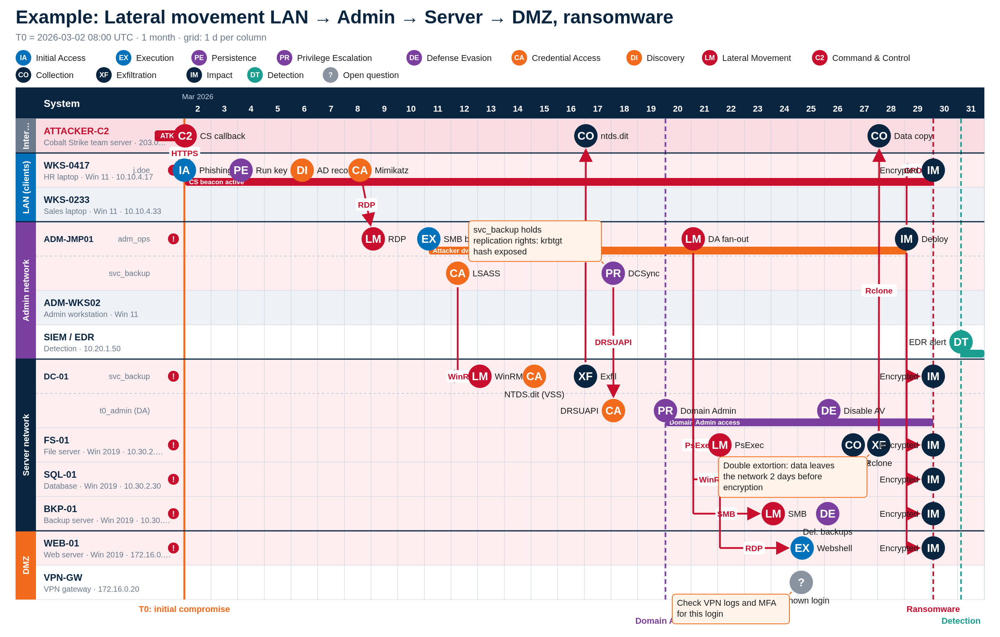
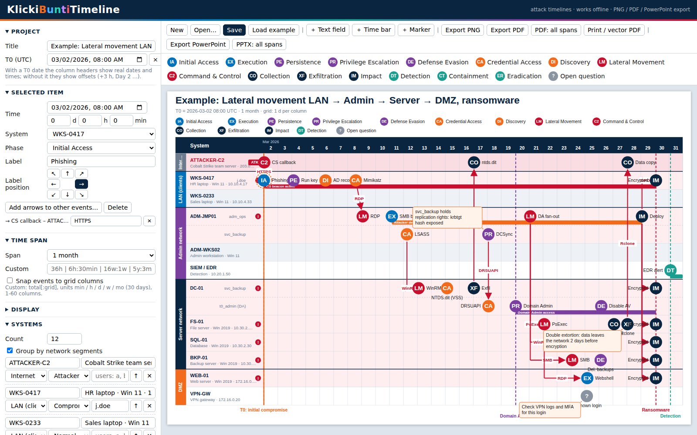

# KlickiBuntiTimeline

**A single-file timeline editor for cyber-attack investigations.**
Build incident timelines by clicking: one row per system, lateral-movement arrows (also as trees), network segments, time spans from 1 hour to 3 years, and export to PNG, PDF and editable PowerPoint.



- No installation, no server, no dependencies. Open `KlickiBuntiTimeline.html` in a browser.
- Works fully offline. Nothing is sent anywhere; the file contains all code.
- Save and reopen your work as a small JSON file.

---

## Table of contents

1. [Quick start](#quick-start)
2. [Features](#features)
3. [Using the editor](#using-the-editor)
4. [Time spans and T0](#time-spans-and-t0)
5. [Exporting](#exporting)
6. [Save file format](#save-file-format)
7. [Example](#example)
8. [Repository layout](#repository-layout)
9. [Companion CLI (PPTX generator)](#companion-cli-pptx-generator)
10. [Limitations](#limitations)

---

## Quick start

1. Download `KlickiBuntiTimeline.html`.
2. Double-click it (or drag it into Chrome, Edge or Firefox).
3. Press **Load example** to see a complete attack, or start from the empty template.

To place something: click an attack-phase icon in the strip above the canvas, then click in the grid. Click any item to edit it in the side panel.



---

## Features

| Area | What you get |
|---|---|
| Systems | 1-60 systems, one row each; reorder, rename, add a second info line (IP, role, OS) |
| Status | Mark a system as **Normal**, **Compromised** (red marker) or **Attacker** device (red "ATK" chip) |
| Users | Comma-separated user names split one system into **one lane per user** |
| Network segments | Group systems into colored bands; name and **color picker** per segment |
| Events | 16 phase icons (15 ATT&CK-style phases plus a gray **open question** icon), free left/right positioning, optional snap to columns |
| Labels | Label next to each icon, placeable in 8 directions (N, NE, E, SE, S, SW, W, NW) |
| Arrows | Lateral movement arrows from one event to **several targets** (tree layout), each arrow with a **text label** (for example `RDP`); straight or elbow style |
| Time bars | Draw spans in a row (dwell time, active beacon, containment) with color and label |
| Markers | Vertical dashed markers with label (T0, Domain Admin, ransomware start, detection) |
| Text fields | Free notes or notes **attached** to an event or a system, placeable in 8 directions |
| Legend | Optional, above the table, optionally only for icons in use; **icons can be renamed** (code and name) and the legend follows |
| Time axis | Relative offsets (`+3 h`, `Day 2`) or **real dates and times** when T0 is set |
| Time spans | 1 h, 3 h, 6 h, 12 h, 24 h, 2 d, 3 d, 1 w, 2 w, 3 w, 1 m, 2 m, 3 m, 6 m, 12 m, 18 m, 2 y, 3 y, plus custom spans |
| Export | PNG, PDF (one span or all spans), vector PDF via print, **editable PowerPoint** (one slide or one per span) |
| Persistence | Save/open as JSON; last state is also kept automatically in the browser |

---

## Using the editor

### Placing and editing events

- **Place:** pick a phase icon in the strip, click in the grid. The tool stays active so you can place several; press `Esc` or click the icon again to stop.
- **Move:** drag an icon left/right (time) or up/down (system or user lane). By default positions are free; enable **Snap events to grid columns** under *Time span* to snap to column centers.
- **Edit:** click an icon. The side panel shows time, system, user lane, phase, label and label position.
- **Delete:** `Delete` key or the Delete button in the panel.

### Arrows (lateral movement, trees)

1. Select the source event.
2. Click **Add arrows to other events…**.
3. Click each target event. Clicking a target again removes that arrow.
4. Click **Done adding arrows** or press `Esc`.

Every arrow can get a label in the side panel (protocol, tool, technique). With the *Tree (elbow)* style under **Display**, arrows from one source share a vertical trunk and branch horizontally into the target rows.

### Time bars and markers

- **＋ Time bar:** press the button, then drag across a system row. Edit start, end, color and label in the panel; drag a bar to move it.
- **＋ Marker:** press the button, then click in the grid. Edit time, color and label; drag to move.

### Systems, users and segments

- Set the number of systems or add them one by one. Use ↑ to move a row up and ✕ to remove it.
- Per system: name, info line, segment, status and users.
- Enable **Group by network segments** to show segment bands. Systems are grouped by their segment; name and color of each segment are edited in the *Network segments* section.
- Users: entering `alice, bob` creates two lanes inside that system's row. Choose the lane for each event or bar in the panel.

### Text fields

Press **＋ Text field**. If an event is selected, the note attaches to it; otherwise it is free. A free note stays at its time and row position. An attached note follows its event or system and can be placed in any of 8 directions relative to the anchor. Drag the box to fine-tune the offset.

### Legend and icon names

Under **Display**, switch on **Show legend above the table**. Rename any icon (code up to 3 characters, and name); the palette, the editor and the legend use the new names. **Reset names** restores the defaults.

### Keyboard

| Key | Action |
|---|---|
| `Esc` | Stop placing, stop adding arrows |
| `Delete` | Delete the selected item (not while typing in a field) |

---

## Time spans and T0

Choose a preset under **Time span**:

| Preset | Span | One column |
|---|---|---|
| 1 hour | 60 min | 5 min |
| 3 hours | 3 h | 15 min |
| 6 hours | 6 h | 30 min |
| 12 hours | 12 h | 1 h |
| 24 hours | 24 h | 1 h |
| 2 days | 48 h | 4 h |
| 3 days | 72 h | 6 h |
| 1 week | 7 d | 1 d |
| 2 weeks | 14 d | 1 d |
| 3 weeks | 21 d | 1 d |
| 1 month | 30 d | 1 d |
| 2 months | 9 weeks | 1 week |
| 3 months | 13 weeks | 1 week |
| 6 months | 26 weeks | 1 week |
| 12 months | 12 "months" | 1 month |
| 18 months | 18 "months" | 1 month |
| 2 years | 24 "months" | 1 month |
| 3 years | 36 "months" | 1 month |

Here a **month is 30 days** in all spans, so "12 months" is 360 days.

**Custom spans** use `total` or `total:grid`, for example `36h`, `6h:30min`, `16w:1w`, `5y`-style spans as `60mo:2mo`. Units: `min`, `h`, `d`, `w`, `mo` (30 days). Total divided by grid must be a whole number between 1 and 60.

**T0:** set the start date and time (UTC) under *Project*. Then column headers show real dates and times (for example `14 Mar` / `08:00`), and the time fields in the editor offer a date-time picker next to day/hour/minute offsets. Without T0, headers show relative offsets.

Events keep their absolute time (minutes after T0). Switching the span never moves them; items beyond the visible span are hidden and the tool tells you so.

---

## Exporting

| Button | Result |
|---|---|
| Export PNG | Current span, 2x resolution |
| Export PDF | Current span, one page (image-based PDF) |
| PDF: all spans | One page per preset span |
| Print / vector PDF | Opens the browser print dialog; choose "Save as PDF" for a vector PDF with selectable text (landscape, header and side panel hidden) |
| Export PowerPoint | One `.pptx` slide of the current span |
| PPTX: all spans | One slide per preset span |

The PowerPoint export is **native and editable**: rows, labels, icons, arrows, bars, markers, legend and text fields are real shapes and text boxes, not a screenshot. The slide is 13.33 in wide; its height follows the number of rows. PowerPoint's font metrics differ slightly from the browser's, so very long labels can be a little wider or narrower than on screen.

---

## Save file format

`Save` writes a JSON file named `<title>.timeline.json`; `Open…` reads it. Older files remain loadable; missing fields are filled with defaults.

All times are **minutes after T0**.

```jsonc
{
  "v": 2,
  "title": "Incident Timeline",
  "t0": "2026-03-02T08:00",            // UTC, "" = no date
  "span": "1m",                         // preset key or custom span
  "seg": true,                          // group by network segments
  "snap": false,                        // snap events to columns
  "ls": "elbow",                        // arrow style: "elbow" | "straight"
  "lg": { "on": true, "used": true },   // legend on / only icons in use
  "pn": { "5": { "c": "CA", "n": "Credential Access" } },  // renamed icons by index
  "segs": [ { "n": "LAN", "c": "#0072BC" } ],
  "rows": [ { "id": 2, "n": "WKS-0417", "i": "HR laptop", "s": 0, "k": 1, "u": ["j.doe"] } ],
  "ev":  [ { "id": 100, "r": 2, "ln": 0, "t": 0, "p": 0, "l": "Phishing", "d": "E" } ],
  "lk":  [ { "a": 100, "b": 101, "l": "HTTPS" } ],
  "nt":  [ { "id": 800, "x": "Note text", "w": 170, "fs": 11, "a": { "k": "e", "id": 100 }, "dx": 0, "dy": 0, "d": "NE" } ],
  "bar": [ { "id": 500, "r": 2, "ln": 0, "t1": 0, "t2": 40320, "c": "#C8102E", "l": "CS beacon active" } ],
  "mk":  [ { "id": 700, "t": 0, "l": "T0", "c": "#F26B1D" } ],
  "nid": 1000
}
```

| Field | Meaning |
|---|---|
| `rows[].s` | Index into `segs` |
| `rows[].k` | `0` normal, `1` compromised, `2` attacker |
| `rows[].u` | User names; more than one creates lanes |
| `ev[].r` / `ev[].ln` | Row id and user lane index |
| `ev[].p` | Phase index 0-15 (Initial Access, Execution, Persistence, Privilege Escalation, Defense Evasion, Credential Access, Discovery, Lateral Movement, Command & Control, Collection, Exfiltration, Impact, Detection, Containment, Eradication, Open question) |
| `ev[].d`, `nt[].d` | Direction: `N`, `NE`, `E`, `SE`, `S`, `SW`, `W`, `NW` |
| `lk[].a` / `b` | Source and target event ids |
| `nt[].a` | Attachment: `{k:"e"\|"r", id}` for event or row; `null` = free (then `t` and `fy` position it) |

Because it is plain JSON, save files diff well in Git and can be generated by scripts.

The editor also stores the last state in the browser's local storage so a reload does not lose work. For long-term storage use **Save**.

---

## Example

`Load example` (or open `examples/Example_Lateral_Movement.timeline.json`) shows a complete attack across network segments:

- Start in the **LAN** with a phishing mail and a Cobalt Strike beacon (C2 callback to the team server).
- Credential theft and RDP to the **Admin network** jump host.
- Move to the **Server network**: domain controller via WinRM, NTDS.dit extraction from a Volume Shadow Copy, exfiltration.
- Privilege escalation via **DCSync** to Domain Admin.
- Fan-out to file, SQL and backup servers (tree arrows), then access to the **DMZ**.
- Backup deletion, data staging and Rclone exfiltration, then a **ransomware** rollout and detection/containment.

The example uses user lanes, attacker and compromised markers, time bars, markers, notes and the legend.

---

## Repository layout

Suggested layout for this repository:

```
KlickiBuntiTimeline.html          the tool (single file)
README.md
docs/
  example-timeline.png            exported example
  screenshot-gui.png              editor screenshot
examples/
  Example_Lateral_Movement.timeline.json
```

---

## Companion CLI (PPTX generator)

The folder `incident-timeline-tool` (suggested name `cli/`) contains a separate Node.js command-line tool that generates PowerPoint timeline templates from a configuration file: any number of systems, optional network segments, free time spans, up to 40 systems per slide, event/IOC tables and an icon library. It is independent of the browser tool. See its own README for installation (`npm install`) and the configuration examples.

---

## Limitations

- Phase markers are colored circles with a short code, not pictograms.
- A month is always 30 days; spans of months and years are approximate.
- The PDF export is image-based; use *Print / vector PDF* for selectable text.
- Items beyond the selected time span are hidden, not clipped.
- Up to 60 systems and 60 columns per timeline.
- No undo/redo yet.
- Tested in headless Chromium. Other browsers should work but have not been tested.

---

Source Code is fully written with Claude.
